<div align="center">

# Kubernetes Docs Assistant

**A measured, production-shaped RAG system over the official Kubernetes documentation.**<br>
Hybrid retrieval (dense + BM25 + RRF), token-aware chunking, incremental indexing, streaming chat with citations —
and a 200-run evaluation with confidence intervals that decided the default configuration.

[](backend/pyproject.toml)
[](backend/app/main.py)
[](frontend/package.json)
[](docker-compose.yml)
[](backend/tests)
[](LICENSE)

**English** · [Русский](README.ru.md)

</div>

<p align="center">
  
</p>

<sub>Recorded on the real stack — restored index, local embeddings, live LLM — and sped up 1.5×. Real timings for this answer: query embedding 65 ms, vector search 20 ms, BM25 132 ms, first token 2.3 s.</sub>

---

> **Reviewing this repo in a few minutes?**
> Decisions and their evidence → [evaluation report](docs/EVALUATION.md) and [architecture decision records](docs/adr/) ·
> the core of retrieval → [`retrieval.py`](backend/app/retrieval.py) (fusion, degradation) and [`token_budget.py`](backend/app/token_budget.py) (token-exact chunking) ·
> the evaluation harness → [`evaluation.py`](backend/app/evaluation.py) · raw per-question results → [`eval/results/`](eval/results/20261119T184220545709Z) ·
> a non-technical summary → [case study](docs/CASE_STUDY.md).

## Results at a glance

50 Russian questions × English documentation × 4 retrieval configurations = **200 evaluated answers**.

| | Best configuration: **sliding-window chunks, hybrid search, no LLM reranker** |
|---|---|
| **Recall@10** | **1.000** — the gold page is in the top 10 for every question |
| **Recall@5** | **0.960** <sub>95% CI 0.90–1.00</sub> |
| **MRR@10** | **0.793** <sub>95% CI 0.71–0.87</sub> — vs 0.660 for heading chunks, **p = 0.003** |
| **Faithfulness** | **0.975** <sub>95% CI 0.96–0.99</sub> — share of answer claims supported by the given context (LLM judge) |
| **Cost of the full benchmark** | **$0.156** for 512 metered API calls (answers, judge, reranker, retries) |

**What the data decided** (details in [docs/EVALUATION.md](docs/EVALUATION.md)):

1. **Chunking matters more than reranking.** Sliding-window chunks beat heading-based chunks on MRR@10 by **+0.133** (95% CI +0.05…+0.22, paired permutation test p = 0.003).
2. **The LLM reranker did not pay for itself.** On window chunks it changed MRR@10 by −0.047 (p = 0.30); on heading chunks +0.096 (p = 0.08, not significant). It adds **17 s median latency** and **35 % of the token bill**. It is therefore **off by default** and available as a toggle.
3. **Fixing the pipeline beat adding components.** An audit of the first version found truncated embeddings, dropped code samples and an inflated recall metric. After the fixes, the no-rerank baseline moved from MRR@10 0.35 → 0.79 — it now outperforms the old *reranked* pipeline.
4. **It knows what it does not know.** On 20 questions the docs cannot answer — invented flags, removed APIs, other products — it fabricated **0** answers, and it refused **0** of the 200 answerable benchmark questions.

<picture>
  <source media="(prefers-color-scheme: dark)" srcset="docs/assets/charts/quality-dark.svg">
  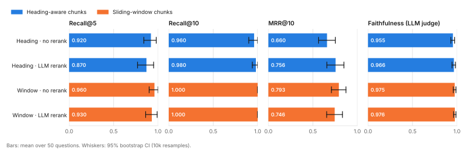
</picture>

## What it does

- **Answers questions about Kubernetes in the user's language** (tested with Russian questions over English docs), grounded only in retrieved documentation, with numbered citations that link to the exact section on kubernetes.io.
- **Streams** the answer token by token; sources appear *before* the first token, so the user sees what the answer is based on.
- **Understands follow-ups** — "and how do I roll it back?" is rewritten into a standalone query before retrieval.
- **Explains itself** — every answer has a *Retrieval details* panel: the BM25 query that was run, dense/BM25 ranks, RRF and rerank scores, per-stage latency.
- **Degrades gracefully** — if the reranker or query translation fails, the chat falls back to hybrid order and says so; authentication/billing errors are never hidden. Evaluation runs in strict mode, where any provider error stops the run instead of silently changing a metric.
- **Keeps the index fresh cheaply** — a new docs release re-embeds only pages whose content hash changed.

## Architecture

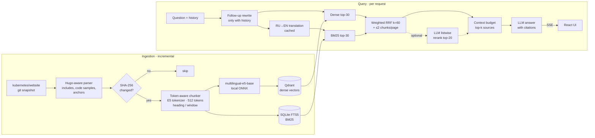

| Layer | Choice | Why |
|---|---|---|
| Embeddings | `intfloat/multilingual-e5-base`, local ONNX via FastEmbed | Cross-lingual (RU query ↔ EN docs), free to run, no data leaves the machine |
| Chunking | Exact E5 tokenizer, 512-token budget incl. `passage:` prefix and headings, 64-token overlap | Character limits silently truncated 22–33 % of chunks in v1 |
| Lexical search | SQLite FTS5 BM25 with field weights (title 3 · heading 2 · body 1) on an LLM-translated English query | Exact API names / flags; zero extra infrastructure |
| Fusion | Weighted Reciprocal Rank Fusion, diversity cap 2 chunks per page | Score-scale free; stops one long page from filling the context |
| Reranker | Optional listwise LLM reranker with strict JSON validation | Measured, then turned off by default (see results) |
| Generation | Any OpenAI-compatible model; evaluated with `glm-5.3-flash` | Provider-agnostic; costs tracked per call |
| API | FastAPI, Server-Sent Events | Sources first, then tokens; stop/abort from the UI |
| Frontend | React 19 + TypeScript + Vite, served by nginx on the same origin | No CORS, no build-time API URL |

More detail — parsing, incremental indexing, failure handling, the evaluation harness — in [docs/ARCHITECTURE.md](docs/ARCHITECTURE.md).

## Evaluation

### Dataset and method

- **50 hand-written questions in Russian** covering workloads, networking, configuration, security, storage, scheduling, operations and the API — each with a reference answer and gold page URL(s) on kubernetes.io ([`eval/questions.jsonl`](eval/questions.jsonl)).
- **Index:** `kubernetes/website@a96b3eb`, 1,730 pages → 19,463 heading chunks / 12,625 window chunks; max 509 tokens, 0 chunks over the 512 limit.
- **Configurations:** {heading, window} × {no rerank, LLM rerank}; identical questions, index, models and prompts.
- **Metrics:** Recall@k (share of gold pages in the top k, page-level), MRR@10 (first relevant chunk), Hit@5, and faithfulness — an LLM judge scores the share of answer claims supported by *exactly* the context the generator saw.
- **Statistics:** 95 % percentile bootstrap CIs (10,000 resamples over questions); paired sign-flip permutation tests for differences.
- **Provenance:** a manifest pins provider, models, retrieval settings, question hash, source commit and index hashes; every answer, retrieved chunk, rank, judge score and raw API response is committed in [`eval/results/`](eval/results/20261119T184220545709Z).

### Results

| Configuration | Recall@5 | Recall@10 | MRR@10 | Faithfulness |
|---|---:|---:|---:|---:|
| Heading · no rerank | 0.920 <sub>[0.84–0.98]</sub> | 0.960 <sub>[0.90–1.00]</sub> | 0.660 <sub>[0.56–0.75]</sub> | 0.955 <sub>[0.93–0.97]</sub> |
| Heading · LLM rerank | 0.870 <sub>[0.77–0.95]</sub> | 0.980 <sub>[0.94–1.00]</sub> | 0.756 <sub>[0.66–0.85]</sub> | 0.966 <sub>[0.94–0.98]</sub> |
| **Window · no rerank** | **0.960** <sub>[0.90–1.00]</sub> | **1.000** <sub>[1.00–1.00]</sub> | **0.793** <sub>[0.71–0.87]</sub> | 0.975 <sub>[0.96–0.99]</sub> |
| Window · LLM rerank | 0.930 <sub>[0.86–0.99]</sub> | **1.000** <sub>[1.00–1.00]</sub> | 0.746 <sub>[0.66–0.83]</sub> | **0.976** <sub>[0.96–0.99]</sub> |

<sub>Brackets: 95 % bootstrap CI. n = 50 questions per configuration.</sub>

**Where does the first relevant page land?**

<picture>
  <source media="(prefers-color-scheme: dark)" srcset="docs/assets/charts/rank-distribution-dark.svg">
  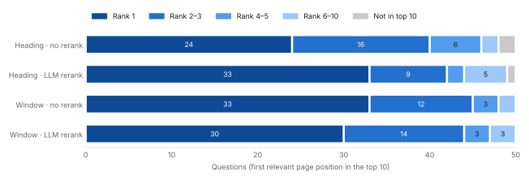
</picture>

**Does the reranker help?** Per-question change in reciprocal rank when the LLM reranker is switched on:

<picture>
  <source media="(prefers-color-scheme: dark)" srcset="docs/assets/charts/rerank-effect-dark.svg">
  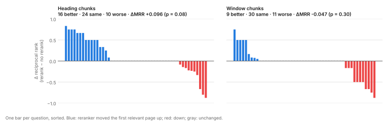
</picture>

The reranker moves many questions in *both* directions: it fixes some poor heading-chunk rankings but disturbs already-good window rankings. With 17 s of extra latency per question, that trade is not worth it as a default.

### Cost and latency of the benchmark

| Operation | Calls (failed) | p50 latency | p90 latency | Input tokens | Output tokens | Cost |
|---|---:|---:|---:|---:|---:|---:|
| Answer generation | 200 (0) | 28.4 s | 39.4 s | 1,025,597 | 153,048 | $0.061 |
| Faithfulness judge | 200 (0) | 15.3 s | 27.0 s | 881,402 | 41,468 | $0.040 |
| LLM rerank (20 candidates) | 112 (11) | 17.1 s | 27.7 s | 1,228,788 | 46,398 | $0.054 |
| **Total** | **512** | | | **3,135,787** | **240,914** | **$0.156** |

<sub>Latency is the provider's wall-clock time for a reasoning model (`glm-5.3-flash`), measured on 144/200/95 calls that logged durations. Cost is computed from returned `usage` and the published tariff; the 11 failed reranker attempts (connection errors, retried) returned no usage, so their cost — if any — is unknown and not counted as zero.</sub>

### After release: live checks and two incidents (25 Nov)

Budget-capped follow-ups against the same model ([details](docs/EVALUATION.md#11-live-checks-after-release)):

| Check | Result |
|---|---|
| **Retrieval ablations** (window, 50 questions, $0) | Hybrid beats dense-only by +0.127 MRR@10 (p = 0.019) and BM25-only by +0.128 (p = 0.004); BM25 on the untranslated Russian question drops to 0.443. On heading chunks fusion adds nothing over dense-only (0.652 vs 0.659) — the gain comes from window chunks + hybrid together. RRF k and channel weights barely matter — nothing is tuned to 50 questions. ([ADR 0001](docs/adr/0001-hybrid-retrieval-with-rrf.md)) |
| **Unanswerable questions** (20: out of scope, invented flags/resources, removed APIs, vendor facts) | **0 fabricated** — 12 declined, 8 corrected the premise (e.g. "dockershim was removed in 1.24; use a CRI runtime such as containerd or CRI-O"). Conversely, 0 of 200 answerable benchmark questions were refused. |
| **Citation markers** | The *unchanged* prompt now cites in 50/50 answers (34/50 in the benchmark); a stricter prompt adds nothing measurable (p = 0.56). The gap was provider-side model drift — a control arm prevented crediting the prompt. |

**Incident 1 — the intermittent HTTP 400.** Reproduced live: for about an hour, with short healthy windows, the model's upstream rejected most fresh requests — even "Reply with the single word: ok" — with `400 invalid request`, through two different routers (one labelled it `upstream_rejected`); identical requests had all succeeded that morning. The application was not the cause. It now degrades instead of failing: a failed or slow (> 8 s) query translation falls back to BM25 on the original wording, a failed reranker keeps hybrid order, and an answer-stage failure shows its stage and a diagnostic ID with a retry button. During the outage all 10 test questions were still answered in one run and 7 of 10 in another (the 3 failures were at the answer stage, where no honest fallback exists).

**Incident 2 — a backup full of zeros.** A packaged index restored with every one of its 32,088 vectors equal to zero, while IDs and texts were intact. The original Qdrant had stored vectors through memory-mapped files on a Windows bind mount; it served correct vectors from RAM (the benchmark's dense scores are a healthy 0.80–0.91) while the files on disk were not. The earlier restore check compared zeros with zeros and passed. Fixes: Qdrant now uses a named volume; `verify-index` checks vector norms and re-embeds a random sample against the stored text; `repair-vectors` rebuilt all vectors from the stored chunk text without re-chunking. The repaired index reproduces the benchmark exactly: **50/50 identical top-10 lists**. ([ADR 0006](docs/adr/0006-qdrant-named-volume.md))

### The audit: what changed between v1 and v4

The first version reported Recall@5 = 0.62–0.92. A code and data audit found that the numbers were partly wrong and partly flattered by the reranker:

| Problem found in v1 | Fix in v4 |
|---|---|
| 3,935 / 18,121 heading and 3,940 / 12,019 window chunks exceeded E5's 512-token limit (max 1,417) and were **silently truncated** | Chunk boundaries computed with the real tokenizer, budget includes prefix + headings + special tokens |
| Hugo `code_sample` / `include` shortcodes were deleted — **YAML examples were missing** from the index | Local samples and includes are expanded and part of the page hash |
| "Recall" was actually HitRate | Recall = share of gold pages found; HitRate reported separately |
| Judge saw 10 chunks while the generator saw 8; JSON parse errors became **score 0** | Judge gets exactly the generator's context; invalid output is retried, never scored |
| No provenance; runs could not be resumed safely | Manifest + per-stage checkpoints + raw API log; resume refuses if anything changed |

<picture>
  <source media="(prefers-color-scheme: dark)" srcset="docs/assets/charts/audit-impact-dark.svg">
  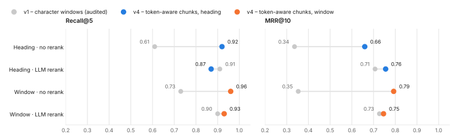
</picture>

<sub>v1 numbers are recomputed from its saved retrieval results with the corrected metric. The runs differ in chunking and evaluation code, so this is a before/after of the whole pipeline, not a controlled single-variable experiment. v1 faithfulness is unverified and not shown.</sub>

## Screenshots

| Retrieval details | Evaluation dashboard |
|---|---|
| 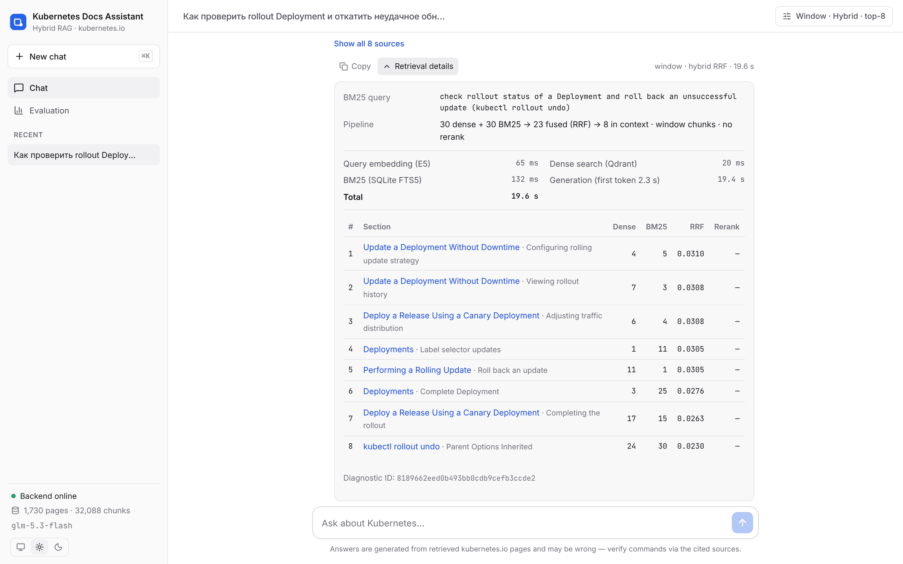 | 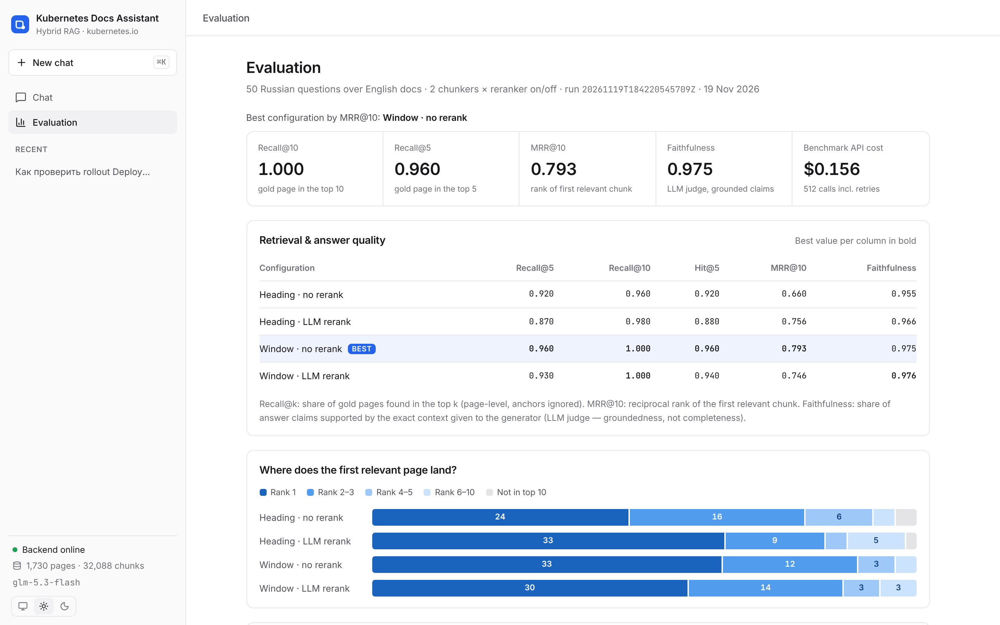 |
| **Hover a citation** | **Per-question matrix** |
| 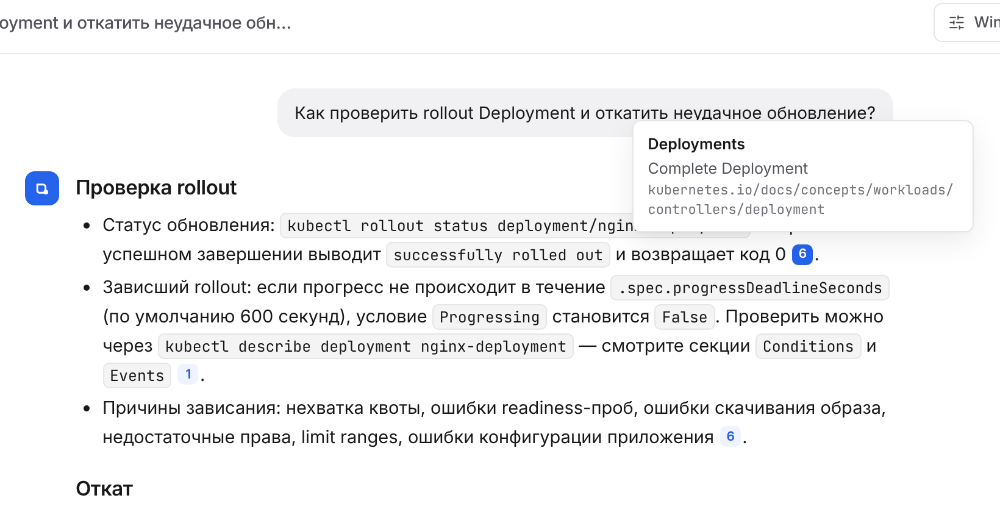 | 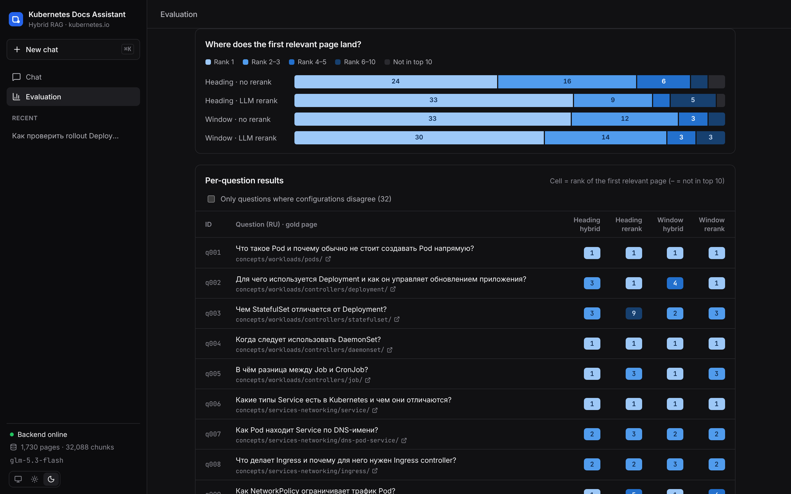 |

<details>
<summary>Empty state and mobile layout</summary>

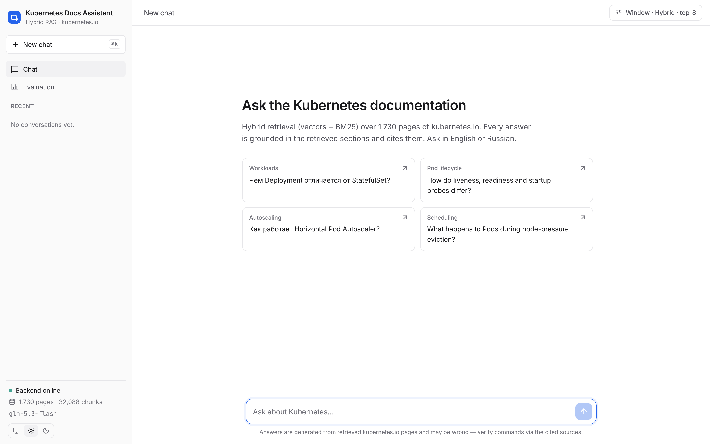 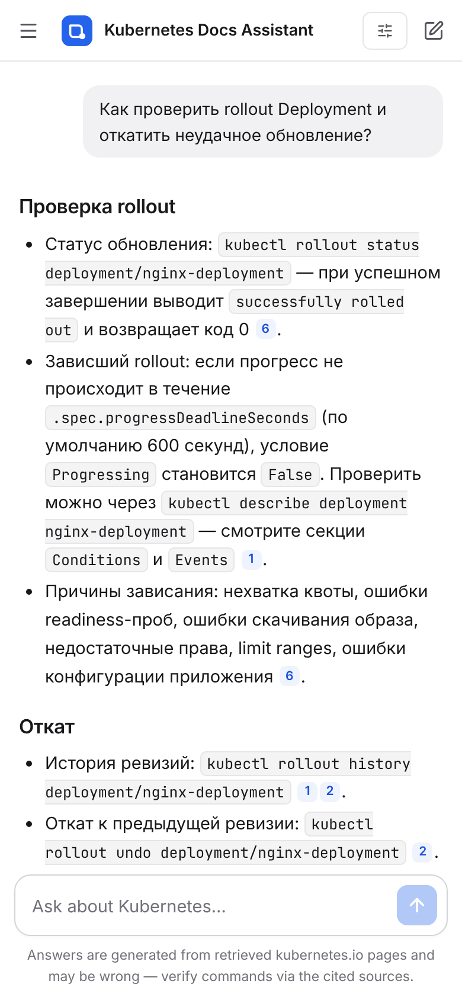

</details>

Screenshots and the demo are recorded by [`scripts/screenshots/live_demo.cjs`](scripts/screenshots/live_demo.cjs) against the running stack: one real question is asked, and every theme and layout is captured from that same conversation.

## Quick start

Requirements: Docker with Compose, ~5 GB free disk, an API key for any OpenAI-compatible LLM endpoint.

```bash
cp .env.example .env          # set OPENAI_API_KEY, OPENAI_BASE_URL, CHAT_MODEL
docker compose up -d --build
```

**Option A — restore the prebuilt index (minutes).** Download `k8s-docs-index-v4.zip` from the [latest release](../../releases/latest) into `./data`, then:

```bash
docker compose exec backend python -m app.cli restore-index /app/data/k8s-docs-index-v4.zip
```

```bash
docker compose exec backend python -m app.cli verify-index --sample 20   # IDs, vector norms, re-embedding check
```

The archive holds both Qdrant collections and the SQLite index for `kubernetes/website@a96b3eb` with a SHA-256 manifest; restore refuses a damaged file. To move to the current docs afterwards, `index --sync --strategy both` re-embeds only the pages that changed since that commit.

**Option B — build from source (hours).** Clone the docs and embed all ~32k chunks locally (the first run downloads the 1.1 GB E5 model; ≈ 120–230 chunks/min on a 4–6-core CPU, resumable; `--strategy window` alone halves the time):

```bash
docker compose exec backend python -m app.cli index --sync --strategy both
```

Open **http://localhost:3000** (UI) or **http://localhost:8088/docs** (OpenAPI).

### Everyday commands

```bash
docker compose exec backend python -m app.cli index --sync --strategy both  # incremental update to the latest docs
docker compose exec backend python -m app.cli index --strategy both --dry-run  # show added / changed / deleted pages
docker compose exec backend python -m app.cli status                         # index state
docker compose exec backend python -m app.cli validate-chunking              # check every chunk ≤ 512 tokens, offline
docker compose exec backend python -m app.cli verify-index                   # index vs docs source, SQLite, Qdrant, re-embedding
docker compose exec backend python -m app.cli repair-vectors                 # re-embed corrupted vectors from stored text
docker compose exec backend python -m app.cli export-index /app/data/index.zip  # package the index for a release
docker compose exec backend python -m app.cli evaluate --no-faithfulness     # retrieval-only eval (no generation cost)
docker compose exec backend python -m app.cli evaluate --with-faithfulness --workers 2  # full eval
docker compose exec backend python -m app.cli resume-evaluation <run-id>     # continue an interrupted run
docker compose exec backend python -m app.cli evaluation-cost <run-id>       # metered token cost of a run
```

Reproduce every number, table and chart in this README from the committed raw results — no API key needed:

```bash
pip install -r scripts/requirements.txt
python scripts/analyze_eval.py
```

### Local development

```bash
cd backend && python -m venv .venv && . .venv/bin/activate
pip install -e ".[dev]"
pytest && ruff check . && ruff format --check .
uvicorn app.main:app --reload --port 8088
```

```bash
cd frontend && npm ci && npm run dev   # http://localhost:5173, proxies /api to :8088
```

## API

| Method | Path | Purpose |
|---|---|---|
| `POST` | `/api/chat/stream` | SSE: `status` → `sources` → `delta`… → `done` / `error` |
| `POST` | `/api/chat` | Same, non-streaming JSON |
| `POST` | `/api/search` | Retrieval only, with trace |
| `GET` | `/api/index/status` | Pages and chunks per strategy |
| `GET` | `/api/eval/latest` | Metrics of the latest run |
| `GET` | `/api/eval/latest/questions` | Per-question ranks and faithfulness for all configurations |
| `GET` | `/health` | Liveness and configured models |

```bash
curl -N http://localhost:8088/api/chat/stream -H 'Content-Type: application/json' \
  -d '{"question": "How do I roll back a Deployment?", "strategy": "window", "rerank": false}'
```

Errors carry the failing stage, model and a diagnostic ID that matches a privacy-preserving log line (usage and latency, no question or answer text).

## Repository layout

```
backend/app/
  docs.py          Hugo-aware parser, token-aware heading/window chunkers
  indexer.py       incremental indexing by content hash (Qdrant + SQLite FTS5)
  retrieval.py     dense + BM25, weighted RRF, diversity, rerank, graceful degradation
  cloud.py         LLM calls: translation, follow-up rewrite, rerank, answer (+stream), judge;
                   per-call usage, cost and latency logging
  evaluation.py    manifest-pinned, resumable, parallel evaluation harness
  main.py          FastAPI app and SSE endpoint
backend/tests/     87 tests (83 offline + 4 against a real Qdrant in CI)
frontend/src/      React UI: chat, citations, retrieval inspector, evaluation dashboard
eval/              questions and the full committed benchmark run
scripts/           offline analysis (CIs, significance, charts), live experiments, demo recording
docs/              architecture, evaluation report, charts, generated tables
```

## Limitations

- **50 questions** is enough to separate chunking strategies (p = 0.003) but not to resolve small effects; most CIs are ±0.05–0.10.
- **Faithfulness is an LLM judgment of groundedness**, by the same model family that generated the answers. It does not measure completeness or correctness against the reference answer.
- **Hosted models drift:** in the benchmark 24–34 of 50 answers per configuration carried `[n]` markers; a re-run six days later with the same prompt gave 50/50. Numbers measured against a hosted model are a snapshot.
- **Single gold page per question** is conservative: most "late" hits are relevant tutorials, task pages or glossary entries rather than misses (see [error analysis](docs/EVALUATION.md#5-error-analysis)).
- **One model, one upstream.** Both routers available for testing shared the same upstream and failed together during the outage; a production deployment should add an independent second provider for the answer stage.

## License

Source code: [Apache License 2.0](LICENSE) · © 2026 GhostCorp.<br>
Kubernetes documentation excerpts in `eval/results/` and screenshots: © The Kubernetes Authors, [CC BY 4.0](LICENSES/CC-BY-4.0.txt) — see [NOTICE](NOTICE).
