<div align="center">

# Kubernetes Docs Assistant

**Измеренная RAG-система «как в продакшене» по официальной документации Kubernetes.**<br>
Гибридный поиск (векторы + BM25 + RRF), чанкинг по токенам, инкрементальная индексация, стриминговый чат с цитатами —
и оценка на 200 прогонах с доверительными интервалами, по которой выбрана конфигурация по умолчанию.

[](backend/pyproject.toml)
[](backend/app/main.py)
[](frontend/package.json)
[](docker-compose.yml)
[](backend/tests)
[](LICENSE)

[English](README.md) · **Русский**

</div>

<p align="center">
  
</p>

<sub>Запись с настоящего стека — восстановленный индекс, локальные эмбеддинги, живая LLM — ускорена в 1.5 раза. Реальные тайминги этого ответа: эмбеддинг запроса 65 мс, векторный поиск 20 мс, BM25 132 мс, первый токен 2.3 с.</sub>

---

> **Смотрите репозиторий за несколько минут?**
> Решения и доказательства → [отчёт об оценке](docs/EVALUATION.md) и [записи архитектурных решений](docs/adr/) ·
> ядро поиска → [`retrieval.py`](backend/app/retrieval.py) (слияние, деградация) и [`token_budget.py`](backend/app/token_budget.py) (чанкинг по токенам) ·
> система оценки → [`evaluation.py`](backend/app/evaluation.py) · сырые результаты по вопросам → [`eval/results/`](eval/results/20261119T184220545709Z) ·
> описание для заказчика → [кейс](docs/CASE_STUDY.ru.md).

## Результаты коротко

50 вопросов на русском × английская документация × 4 конфигурации retrieval = **200 оценённых ответов**.

| | Лучшая конфигурация: **скользящее окно, гибридный поиск, без LLM-reranker** |
|---|---|
| **Recall@10** | **1.000** — эталонная страница в топ-10 для каждого вопроса |
| **Recall@5** | **0.960** <sub>95% ДИ 0.90–1.00</sub> |
| **MRR@10** | **0.793** <sub>95% ДИ 0.71–0.87</sub> — против 0.660 у чанков по заголовкам, **p = 0.003** |
| **Faithfulness** | **0.975** <sub>95% ДИ 0.96–0.99</sub> — доля утверждений ответа, подтверждённых переданным контекстом (LLM-судья) |
| **Стоимость всего бенчмарка** | **$0.156** за 512 учтённых API-вызовов (ответы, судья, reranker, повторы) |

**Что решили данные** (подробно — [docs/EVALUATION.md](docs/EVALUATION.md), на английском):

1. **Чанкинг важнее reranker-а.** Окна вместо разбиения по заголовкам дают **+0.133** MRR@10 (95% ДИ +0.05…+0.22, парный перестановочный тест p = 0.003).
2. **LLM-reranker себя не окупил.** На окнах он изменил MRR@10 на −0.047 (p = 0.30), на заголовках на +0.096 (p = 0.08, незначимо). При этом добавляет **17 с медианной задержки** и **35 % стоимости токенов**. Поэтому по умолчанию он **выключен** и доступен переключателем.
3. **Исправить пайплайн выгоднее, чем добавлять компоненты.** Аудит первой версии нашёл обрезанные эмбеддинги, выпавшие примеры кода и завышенную метрику recall. После исправлений базовая конфигурация без reranker выросла по MRR@10 с 0.35 до 0.79 и обогнала старую версию *с* reranker-ом.
4. **Знает, чего не знает.** На 20 вопросах, на которые в документации нет ответа (выдуманные флаги, удалённые API, другие продукты), — **0** выдуманных ответов, и **0** отказов на 200 отвечаемых вопросах бенчмарка.

<picture>
  <source media="(prefers-color-scheme: dark)" srcset="docs/assets/charts/quality-dark.svg">
  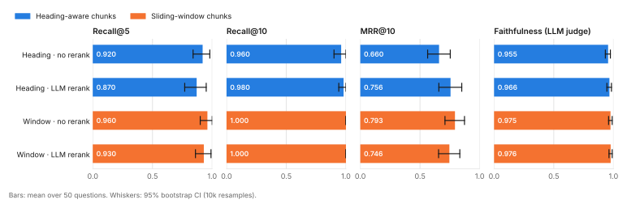
</picture>

## Что умеет

- **Отвечает на вопросы о Kubernetes на языке пользователя** (проверено на русских вопросах к английской документации), опираясь только на найденные разделы, с нумерованными ссылками на конкретный раздел kubernetes.io.
- **Стримит** ответ по токенам; источники приходят *до* первого токена — видно, на чём основан ответ.
- **Понимает уточняющие вопросы** — «а как её откатить?» переписывается в самостоятельный запрос перед поиском.
- **Объясняет себя** — у каждого ответа есть панель *Retrieval details*: выполненный BM25-запрос, ранги dense/BM25, оценки RRF и reranker-а, задержка по этапам.
- **Деградирует аккуратно** — если reranker или перевод запроса упали, чат вернёт гибридную выдачу и честно об этом скажет; ошибки авторизации и баланса никогда не скрываются. Eval работает в строгом режиме: любая ошибка провайдера останавливает прогон, а не меняет метрику молча.
- **Дёшево поддерживает актуальность** — при выходе новой версии документации переэмбеддятся только страницы с изменившимся хэшем.

## Архитектура

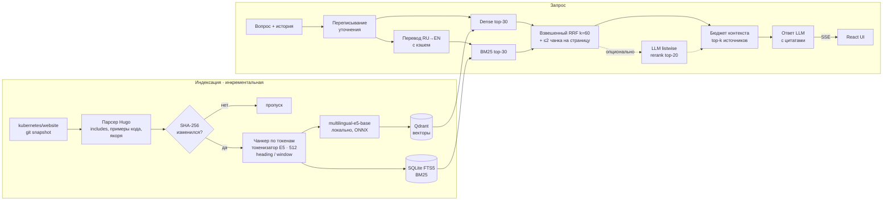

| Слой | Решение | Почему |
|---|---|---|
| Эмбеддинги | `intfloat/multilingual-e5-base`, локально через FastEmbed/ONNX | Кросс-языковой поиск (RU-вопрос ↔ EN-документация), бесплатно, данные не уходят наружу |
| Чанкинг | Точный токенизатор E5, бюджет 512 токенов с учётом `passage:` и заголовков, перекрытие 64 | Лимит по символам в v1 молча обрезал 22–33 % чанков |
| Лексический поиск | SQLite FTS5 BM25 с весами полей (title 3 · heading 2 · body 1) по переведённому LLM английскому запросу | Точные имена API и флагов; без дополнительной инфраструктуры |
| Слияние | Weighted Reciprocal Rank Fusion, не более 2 чанков на страницу | Не нужно калибровать шкалы; одна длинная страница не забивает контекст |
| Reranker | Опциональный listwise LLM-reranker со строгой валидацией JSON | Измерен и выключен по умолчанию (см. результаты) |
| Генерация | Любая OpenAI-совместимая модель; оценено на `glm-5.3-flash` | Независимость от провайдера; стоимость учитывается по каждому вызову |
| API | FastAPI, Server-Sent Events | Сначала источники, потом токены; остановка из UI |
| Фронтенд | React 19 + TypeScript + Vite за nginx на том же origin | Без CORS и без «зашитого» адреса API |

Подробности — парсинг, инкрементальная индексация, обработка сбоев, eval-харнесс — в [docs/ARCHITECTURE.md](docs/ARCHITECTURE.md).

## Оценка качества

### Данные и методика

- **50 вопросов на русском**, написанных вручную: workloads, сеть, конфигурация, безопасность, хранилища, планирование, эксплуатация, API. У каждого — эталонный ответ и URL эталонных страниц ([`eval/questions.jsonl`](eval/questions.jsonl)).
- **Индекс:** `kubernetes/website@a96b3eb`, 1 730 страниц → 19 463 чанка по заголовкам / 12 625 оконных; максимум 509 токенов, превышений лимита 512 — 0.
- **Конфигурации:** {heading, window} × {без reranker, LLM-reranker}; одинаковые вопросы, индекс, модели и промпты.
- **Метрики:** Recall@k (доля эталонных страниц в топ-k, на уровне страницы), MRR@10 (первый релевантный чанк), Hit@5 и faithfulness — LLM-судья оценивает долю утверждений, подтверждённых *ровно тем* контекстом, который видел генератор.
- **Статистика:** 95 % перцентильные бутстреп-интервалы (10 000 ресэмплов по вопросам); парные перестановочные тесты для разниц.
- **Происхождение данных:** manifest фиксирует провайдера, модели, настройки retrieval, хэш вопросов, коммит исходников и хэши индексов; каждый ответ, найденный чанк, ранг, оценка судьи и сырой ответ API лежат в [`eval/results/`](eval/results/20261119T184220545709Z).

### Результаты

| Конфигурация | Recall@5 | Recall@10 | MRR@10 | Faithfulness |
|---|---:|---:|---:|---:|
| Heading · без reranker | 0.920 <sub>[0.84–0.98]</sub> | 0.960 <sub>[0.90–1.00]</sub> | 0.660 <sub>[0.56–0.75]</sub> | 0.955 <sub>[0.93–0.97]</sub> |
| Heading · LLM-reranker | 0.870 <sub>[0.77–0.95]</sub> | 0.980 <sub>[0.94–1.00]</sub> | 0.756 <sub>[0.66–0.85]</sub> | 0.966 <sub>[0.94–0.98]</sub> |
| **Window · без reranker** | **0.960** <sub>[0.90–1.00]</sub> | **1.000** <sub>[1.00–1.00]</sub> | **0.793** <sub>[0.71–0.87]</sub> | 0.975 <sub>[0.96–0.99]</sub> |
| Window · LLM-reranker | 0.930 <sub>[0.86–0.99]</sub> | **1.000** <sub>[1.00–1.00]</sub> | 0.746 <sub>[0.66–0.83]</sub> | **0.976** <sub>[0.96–0.99]</sub> |

<sub>В скобках — 95 % бутстреп-интервал. n = 50 вопросов на конфигурацию.</sub>

**На какой позиции оказывается первая релевантная страница?**

<picture>
  <source media="(prefers-color-scheme: dark)" srcset="docs/assets/charts/rank-distribution-dark.svg">
  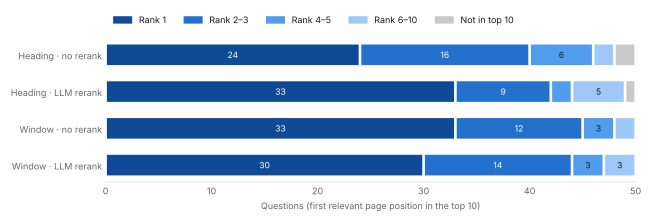
</picture>

**Помогает ли reranker?** Изменение обратного ранга по каждому вопросу при включении LLM-reranker-а:

<picture>
  <source media="(prefers-color-scheme: dark)" srcset="docs/assets/charts/rerank-effect-dark.svg">
  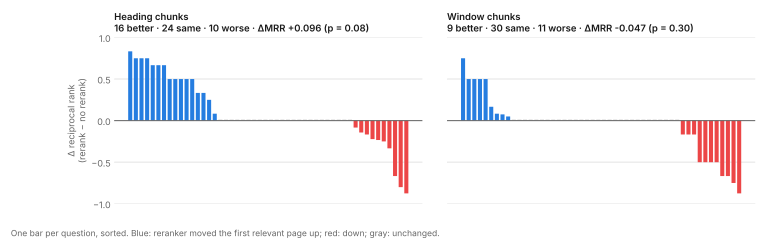
</picture>

Reranker двигает многие вопросы в *обе* стороны: исправляет часть плохих ранжирований на heading-чанках, но портит уже хорошие на оконных. При +17 с на вопрос это невыгодно как поведение по умолчанию.

### Стоимость и задержки бенчмарка

| Операция | Вызовы (ошибки) | p50 | p90 | Входные токены | Выходные токены | Стоимость |
|---|---:|---:|---:|---:|---:|---:|
| Генерация ответа | 200 (0) | 28.4 с | 39.4 с | 1 025 597 | 153 048 | $0.061 |
| Судья faithfulness | 200 (0) | 15.3 с | 27.0 с | 881 402 | 41 468 | $0.040 |
| LLM-rerank (20 кандидатов) | 112 (11) | 17.1 с | 27.7 с | 1 228 788 | 46 398 | $0.054 |
| **Итого** | **512** | | | **3 135 787** | **240 914** | **$0.156** |

<sub>Задержка — время ответа провайдера для reasoning-модели (`glm-5.3-flash`), посчитана по 144/200/95 вызовам, где длительность записывалась. Стоимость — по возвращённому `usage` и опубликованному тарифу; 11 неудачных попыток reranker-а (обрывы соединения, повторены) usage не вернули, поэтому их возможная стоимость неизвестна и не считается нулём.</sub>

### После релиза: live-проверки и два инцидента (25 ноября)

Проверки с лимитом бюджета на той же модели ([подробности](docs/EVALUATION.md#11-live-checks-after-release)):

| Проверка | Результат |
|---|---|
| **Абляции поиска** (window, 50 вопросов, $0) | Гибрид лучше только векторов на +0.127 MRR@10 (p = 0.019) и только BM25 на +0.128 (p = 0.004); BM25 по непереведённому русскому вопросу падает до 0.443. На чанках по заголовкам слияние ничего не даёт по сравнению с одними векторами (0.652 против 0.659) — выигрыш даёт именно связка «окна + гибрид». k и веса RRF почти не влияют — ничего не подогнано под 50 вопросов. ([ADR 0001](docs/adr/0001-hybrid-retrieval-with-rrf.md)) |
| **Вопросы без ответа в документации** (20: вне темы, выдуманные флаги и ресурсы, удалённые API, факты облачных провайдеров) | **0 выдумок** — 12 корректных отказов, 8 исправлений ложной посылки (например, «dockershim удалён в 1.24; используйте CRI-runtime: containerd или CRI-O»). И наоборот: ни один из 200 ответов бенчмарка на отвечаемые вопросы не был отказом. |
| **Маркеры цитат** | *Тот же* промпт теперь даёт ссылки в 50 из 50 ответов (в бенчмарке — 34 из 50); строгий промпт ничего измеримо не добавляет (p = 0.56). Причина — дрейф модели у провайдера; контрольная группа не дала приписать эффект промпту. |

**Инцидент 1 — «случайные» HTTP 400.** Воспроизведён вживую: около часа, с короткими нормальными окнами, upstream модели отклонял большинство новых запросов — даже «Reply with the single word: ok» — ответом `400 invalid request`, причём через два разных роутера (один подписывал это как `upstream_rejected`); утром те же запросы проходили все. Причина не в приложении. Теперь оно деградирует, а не падает: неудачный или медленный (> 8 с) перевод запроса — BM25 по исходной формулировке, сбой reranker-а — гибридный порядок, сбой генерации — этап, diagnostic ID и кнопка повтора. Во время сбоя в одном прогоне ответ получили все 10 тестовых вопросов, в другом — 7 из 10 (3 сбоя на этапе генерации, где честного обходного пути нет).

**Инцидент 2 — резервная копия из нулей.** Упакованный индекс восстановился с нулевыми значениями во всех 32 088 векторах при целых ID и текстах. Исходный Qdrant хранил векторы через memory-mapped файлы на bind-mount в Windows: работающий сервис отдавал правильные векторы из памяти (dense-оценки в бенчмарке — нормальные 0.80–0.91), а файлы на диске были испорчены. Прежняя проверка восстановления сравнивала нули с нулями и проходила. Исправления: Qdrant на именованном томе; `verify-index` проверяет нормы векторов и пересчитывает выборку по сохранённому тексту; `repair-vectors` восстановил все векторы из текста чанков без повторного чанкинга. Исправленный индекс воспроизводит бенчмарк точно: **50 из 50 идентичных top-10**. ([ADR 0006](docs/adr/0006-qdrant-named-volume.md))

### Аудит: что изменилось между v1 и v4

Первая версия показывала Recall@5 = 0.62–0.92. Аудит кода и данных показал, что цифры частично неверны, а частично «вытянуты» reranker-ом:

| Проблема в v1 | Исправление в v4 |
|---|---|
| 3 935 / 18 121 heading и 3 940 / 12 019 window чанков превышали лимит E5 в 512 токенов (максимум 1 417) и **молча обрезались** | Границы чанков считаются настоящим токенизатором, бюджет учитывает префикс, заголовки и служебные токены |
| Шорткоды Hugo `code_sample` / `include` удалялись — **YAML-примеров не было** в индексе | Локальные примеры и includes подставляются и входят в хэш страницы |
| «Recall» на самом деле был HitRate | Recall — доля найденных эталонных страниц; HitRate отдельно |
| Судья видел 10 чанков, а генератор 8; ошибки парсинга JSON превращались в **оценку 0** | Судья получает ровно контекст генератора; некорректный вывод повторяется, а не оценивается |
| Не было provenance; прогоны нельзя было безопасно продолжить | Manifest + чекпоинты по этапам + сырой лог API; resume отказывается, если что-то изменилось |

<picture>
  <source media="(prefers-color-scheme: dark)" srcset="docs/assets/charts/audit-impact-dark.svg">
  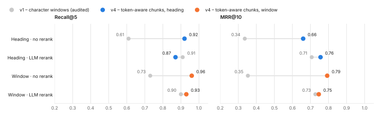
</picture>

<sub>Цифры v1 пересчитаны из сохранённой выдачи исправленной метрикой. Прогоны различаются чанкингом и кодом оценки, поэтому это сравнение «до/после» всего пайплайна, а не контролируемый эксперимент по одной переменной. Faithfulness v1 не верифицирован и не показан.</sub>

## Скриншоты

| Retrieval details | Дашборд оценки |
|---|---|
| 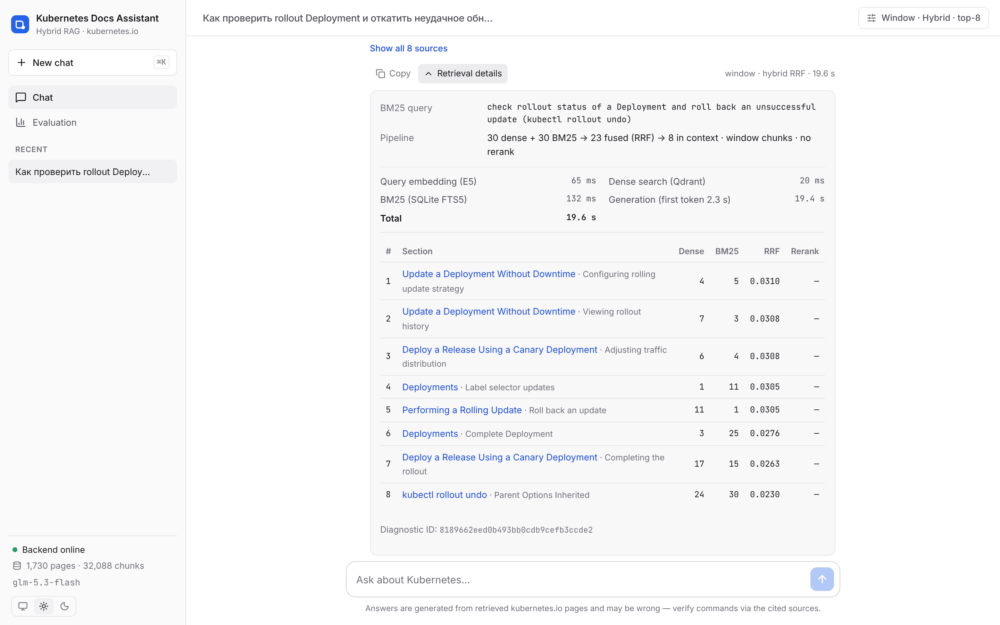 | 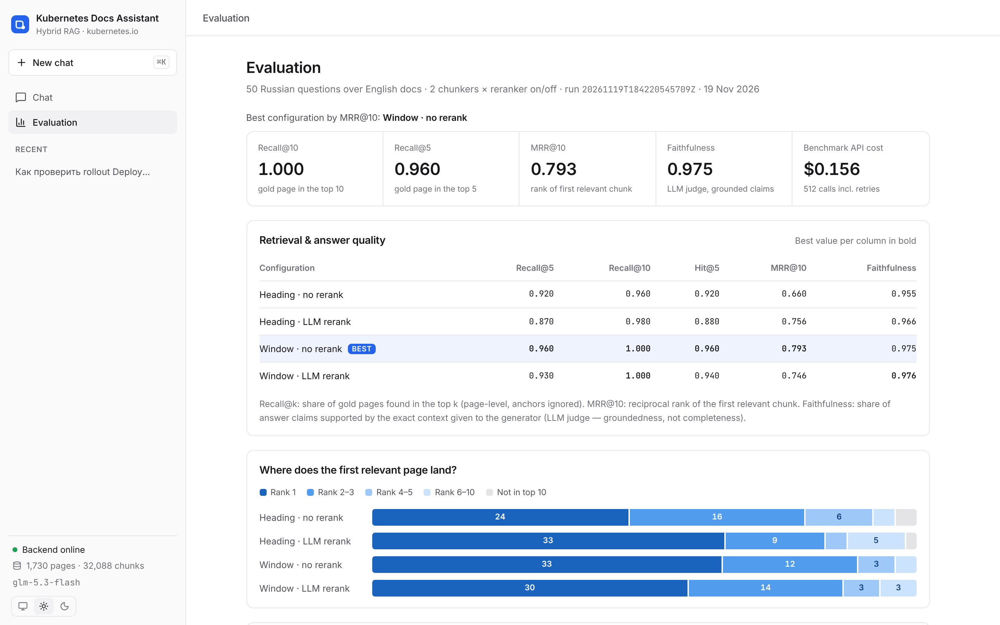 |
| **Подсказка у цитаты** | **Матрица по вопросам** |
| 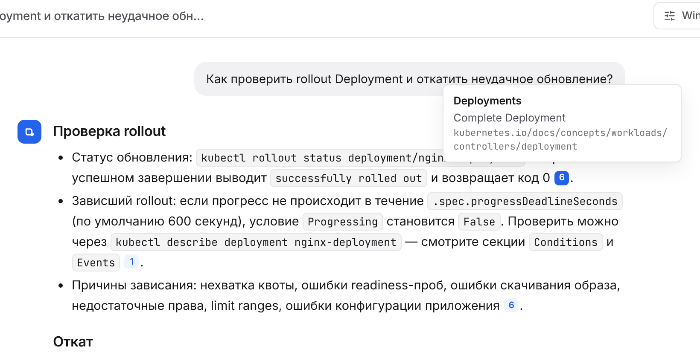 | 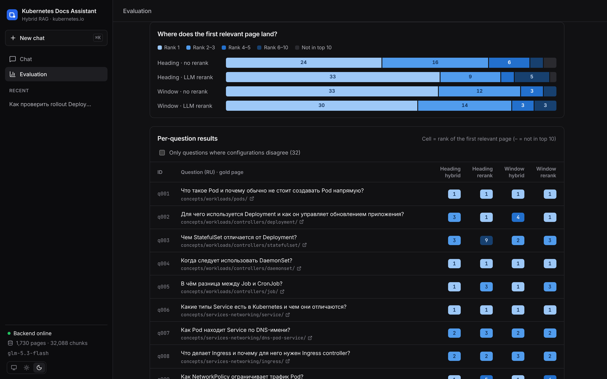 |

<details>
<summary>Пустой экран и мобильная версия</summary>

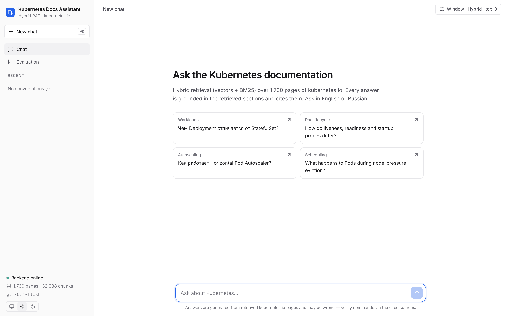 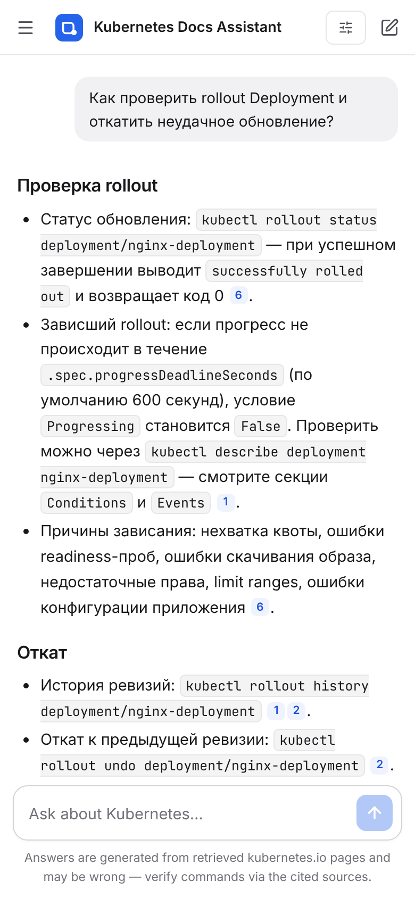

</details>

Скриншоты и демо записывает [`scripts/screenshots/live_demo.cjs`](scripts/screenshots/live_demo.cjs) на работающем стеке: задаётся один настоящий вопрос, и все темы и раскладки снимаются с этого же диалога.

## Быстрый старт

Нужно: Docker с Compose, ~5 ГБ свободного места, ключ к любому OpenAI-совместимому LLM API.

```bash
cp .env.example .env          # укажите OPENAI_API_KEY, OPENAI_BASE_URL, CHAT_MODEL
docker compose up -d --build
```

**Вариант A — восстановить готовый индекс (минуты).** Скачайте `k8s-docs-index-v4.zip` из [последнего релиза](../../releases/latest) в `./data`, затем:

```bash
docker compose exec backend python -m app.cli restore-index /app/data/k8s-docs-index-v4.zip
```

```bash
docker compose exec backend python -m app.cli verify-index --sample 20   # ID, нормы векторов, проверка пересчётом
```

Архив содержит обе коллекции Qdrant и индекс SQLite для `kubernetes/website@a96b3eb` с манифестом SHA-256; повреждённый файл восстановление отвергнет. Чтобы потом перейти на свежую документацию, `index --sync --strategy both` переэмбеддит только страницы, изменившиеся после этого коммита.

**Вариант B — собрать с нуля (часы).** Клонирует документацию и эмбеддит все ~32 тыс. чанков локально (при первом запуске скачивается модель E5, 1.1 ГБ; ≈ 120–230 чанков/мин на 4–6-ядерном CPU, продолжается после прерывания; `--strategy window` вдвое быстрее):

```bash
docker compose exec backend python -m app.cli index --sync --strategy both
```

Откройте **http://localhost:3000** (UI) или **http://localhost:8088/docs** (OpenAPI).

### Основные команды

```bash
docker compose exec backend python -m app.cli index --sync --strategy both     # инкрементальное обновление до свежей документации
docker compose exec backend python -m app.cli index --strategy both --dry-run  # показать добавленные / изменённые / удалённые страницы
docker compose exec backend python -m app.cli status                           # состояние индексов
docker compose exec backend python -m app.cli validate-chunking                # проверить, что все чанки ≤ 512 токенов (офлайн)
docker compose exec backend python -m app.cli verify-index                     # индекс против исходников, SQLite, Qdrant и пересчёта
docker compose exec backend python -m app.cli repair-vectors                   # пересчитать повреждённые векторы из сохранённого текста
docker compose exec backend python -m app.cli export-index /app/data/index.zip # упаковать индекс для релиза
docker compose exec backend python -m app.cli evaluate --no-faithfulness       # eval только retrieval (без затрат на генерацию)
docker compose exec backend python -m app.cli evaluate --with-faithfulness --workers 2  # полный eval
docker compose exec backend python -m app.cli resume-evaluation <run-id>       # продолжить прерванный прогон
docker compose exec backend python -m app.cli evaluation-cost <run-id>         # учтённая стоимость токенов прогона
```

Все цифры, таблицы и графики этого README воспроизводятся из сохранённых сырых результатов — ключ API не нужен:

```bash
pip install -r scripts/requirements.txt
python scripts/analyze_eval.py
```

### Локальная разработка

```bash
cd backend && python -m venv .venv && . .venv/bin/activate
pip install -e ".[dev]"
pytest && ruff check . && ruff format --check .
uvicorn app.main:app --reload --port 8088
```

```bash
cd frontend && npm ci && npm run dev   # http://localhost:5173, проксирует /api на :8088
```

## API

| Метод | Путь | Назначение |
|---|---|---|
| `POST` | `/api/chat/stream` | SSE: `status` → `sources` → `delta`… → `done` / `error` |
| `POST` | `/api/chat` | То же без стриминга, JSON |
| `POST` | `/api/search` | Только retrieval, с трассировкой |
| `GET` | `/api/index/status` | Страницы и чанки по стратегиям |
| `GET` | `/api/eval/latest` | Метрики последнего прогона |
| `GET` | `/api/eval/latest/questions` | Ранги и faithfulness по каждому вопросу и конфигурации |
| `GET` | `/health` | Состояние и настроенные модели |

```bash
curl -N http://localhost:8088/api/chat/stream -H 'Content-Type: application/json' \
  -d '{"question": "Как откатить Deployment?", "strategy": "window", "rerank": false}'
```

Ошибки содержат этап, модель и diagnostic ID, который совпадает со строкой журнала без персональных данных (usage и задержка, без текста вопроса и ответа).

## Структура репозитория

```
backend/app/
  docs.py          парсер Hugo, чанкеры heading/window по токенам
  indexer.py       инкрементальная индексация по хэшу (Qdrant + SQLite FTS5)
  retrieval.py     dense + BM25, взвешенный RRF, диверсификация, rerank, деградация
  cloud.py         вызовы LLM: перевод, переписывание уточнений, rerank, ответ (+stream), судья;
                   учёт usage, стоимости и задержки по каждому вызову
  evaluation.py    eval-харнесс: manifest, resume, параллельность
  main.py          FastAPI и SSE-эндпоинт
backend/tests/     87 тестов (83 офлайн + 4 на настоящем Qdrant в CI)
frontend/src/      React UI: чат, цитаты, панель retrieval, дашборд оценки
eval/              вопросы и полный сохранённый прогон бенчмарка
scripts/           офлайн-анализ (ДИ, значимость, графики), live-эксперименты, запись демо
docs/              архитектура, отчёт об оценке, графики, сгенерированные таблицы
```

## Ограничения

- **50 вопросов** достаточно, чтобы различить стратегии чанкинга (p = 0.003), но не малые эффекты; большинство интервалов ±0.05–0.10.
- **Faithfulness — это LLM-оценка обоснованности**, той же модели, что генерировала ответы. Полноту и правильность относительно эталонного ответа она не измеряет.
- **Модели у провайдера меняются:** в бенчмарке маркеры `[n]` были в 24–34 из 50 ответов на конфигурацию, а повтор через шесть дней с тем же промптом дал 50 из 50. Цифры, измеренные на облачной модели, — это снимок на дату.
- **Одна эталонная страница на вопрос** — консервативная разметка: большинство «поздних» попаданий — релевантные туториалы, task-страницы или глоссарий, а не промахи (см. [error analysis](docs/EVALUATION.md#5-error-analysis)).
- **Одна модель, один upstream.** Оба роутера, доступные для проверки, ходили к одному upstream и падали вместе; в продакшене для этапа генерации нужен независимый второй провайдер.

## Лицензия

Исходный код: [Apache License 2.0](LICENSE) · © 2026 GhostCorp.<br>
Фрагменты документации Kubernetes в `eval/results/` и на скриншотах: © The Kubernetes Authors, [CC BY 4.0](LICENSES/CC-BY-4.0.txt) — см. [NOTICE](NOTICE).
