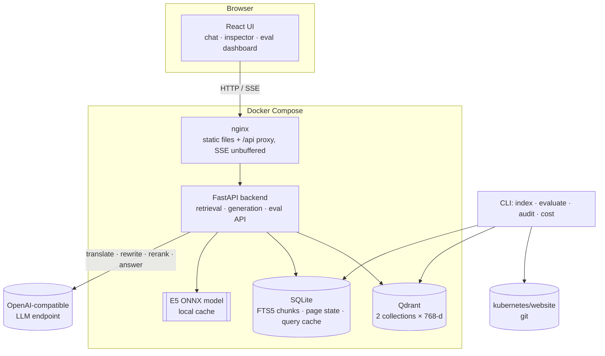
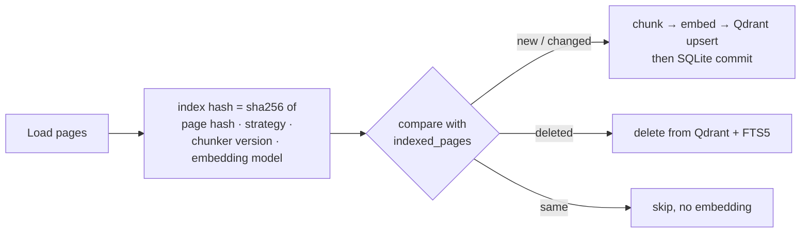

# Architecture

This document explains how the assistant works and why it is built this way. For measured results see [EVALUATION.md](EVALUATION.md).

## Components



| Path | Responsibility |
|---|---|
| `backend/app/docs.py` | Reading Hugo Markdown, expanding shortcodes, URL/anchor derivation, chunking |
| `backend/app/token_budget.py` | Token-exact window splitting with the E5 tokenizer |
| `backend/app/indexer.py` | Incremental indexing into Qdrant and SQLite |
| `backend/app/retrieval.py` | Hybrid search, RRF fusion, diversity, reranking, degradation |
| `backend/app/cloud.py` | All LLM calls, JSON validation, retries, usage/cost/latency logging, streaming |
| `backend/app/main.py` | HTTP API and the SSE endpoint |
| `backend/app/access.py` | Demo access keys: hashed storage, expiry, revocation, per-key and server-wide daily quotas, invalid-key throttle |
| `backend/app/evaluation.py` | Manifest-pinned, checkpointed, resumable, parallel evaluation |
| `backend/app/costs.py`, `estimation.py` | Metered cost of a run; offline cost estimate for a planned run |
| `frontend/src` | UI |
| `scripts/analyze_eval.py` | Offline statistics and charts from committed results |

## 1. Ingestion

**Source.** The `kubernetes/website` repository is cloned (`--sync`) and updated with `fetch` + `merge --ff-only`. The sync refuses to run on a dirty checkout or a different branch rather than discarding local changes.

**Pages.** Every non-draft `*.md` under `content/en/docs` and `content/en/releases` becomes a page with an ID (its relative path), title, canonical kubernetes.io URL (respecting `url:` and `slug:` front matter and branch-bundle `_index.md`) and raw content.

**Hugo shortcodes.** Kubernetes docs pull YAML manifests and shared text in at build time. Indexing the Markdown verbatim would lose them, so the parser expands `code_sample`, `codenew`, `code` (from `content/en/examples`) and `include` (from `content/en/includes`, recursively, depth ≤ 8). Paths are resolved only inside the repository. `` is translated with Hugo's `i18n/en/en.toml`. Shortcodes inside fenced code blocks are left untouched, because the docs contain examples *of* shortcodes.

**Cleaning.** HTML comments and remaining shortcodes are removed and Markdown links reduced to their text — again only outside code fences.

## 2. Chunking

Both strategies use the **real E5 tokenizer** (loaded from the local model cache, never a character estimate). The budget is 512 tokens including the `passage: ` prefix, the title/heading prefix and special tokens; consecutive windows overlap by 64 tokens. Window ends snap back to a paragraph, line or space boundary when one exists in the last 35 % of the window.

| Strategy | Unit | Prefix | Citation anchor |
|---|---|---|---|
| `heading` | One section (text between headings), split into windows only when > 512 tokens | `# Page title` + `## Parent > Section` | The section's own anchor |
| `window` | Sliding windows over the whole cleaned page | `# Page title` | The nearest preceding heading |

Heading anchors follow Hugo: explicit `{#id}` wins, otherwise a slug with `-1`, `-2` suffixes for duplicates, so citation links land on the right section.

`app.cli validate-chunking` re-chunks every page offline and fails if any chunk exceeds 512 tokens. Current snapshot: max 509.

## 3. Incremental indexing



- The **page hash** covers title, URL and the *expanded* content, so an edited YAML sample re-indexes every page that includes it.
- The **index hash** also includes the chunker version and embedding identity: changing either re-indexes everything, never a silent mix of old and new vectors.
- Writes go to Qdrant first and SQLite last; a crash mid-page leaves the page "pending", and the next run redoes it. The command is safe to interrupt and re-run.
- Chunk IDs are deterministic UUIDv5 values of page, strategy, position and content.
- `--dry-run` prints added / changed / deleted / unchanged without touching anything.

## 4. Retrieval

```text
question ──► (follow-up? rewrite to standalone)                         LLM, only with history
         ├─► E5 "query:" embedding ─► Qdrant cosine top-30               local
         └─► RU→EN keyword query (cached in SQLite) ─► FTS5 BM25 top-30  LLM once per distinct question
                 │
                 ▼
     weighted RRF: score = Σ w / (60 + rank)   →  drop duplicate URLs, ≤ 2 chunks per page
                 │
                 ├─► (optional) LLM listwise rerank of the top 20
                 ▼
     top-k (default 8) → trimmed to the character budget → answer context
```

**Why hybrid.** Dense retrieval handles paraphrase and the Russian→English gap; BM25 nails exact identifiers (`PodDisruptionBudget`, `--dry-run=server`, `imagePullPolicy`). RRF combines ranks, so the two score scales never need calibrating.

**Why translate for BM25.** FTS5 cannot match Russian words against English docs. A short LLM call turns the question into an English keyword query that preserves API names and flags; results are cached per question.

**BM25 details.** The FTS5 table indexes title, heading and content with `unicode61 remove_diacritics 2`; `bm25()` weights are 3 / 2 / 1. Every user token is quoted, so input can never be interpreted as FTS syntax.

**Diversity.** At most two chunks per page and one per URL/anchor make it into the candidate list — otherwise one long reference page could occupy the whole context.

**Reranker.** The LLM gets the query and up to 20 candidates (2,400 chars each) and must return JSON with every ID exactly once and a score in [0, 1]. Anything else — invalid JSON, a missing or duplicate ID, NaN, out-of-range score, a truncated completion — raises an error and is retried; it is never treated as "score 0".

### Strict vs graceful

| Situation | Evaluation (`strict=True`) | Chat (`strict=False`) |
|---|---|---|
| Reranker fails | Stop; the stage is retried or the run halts | Keep RRF order, report `rerank_failed` in the trace, show a notice in the UI |
| Translation fails or takes > 8 s | Stop (retried, no time cap) | One attempt; BM25 uses the original question, report `translation_failed` |
| 401 / 402 / 403 from the provider | Stop | Stop — a broken key or empty balance must be visible |

Evaluation must never let a provider hiccup silently change a metric; a user would rather get an answer from hybrid search than an error.

## 5. Generation

- **Context:** the top-k sources, each as `SOURCE [n]` with title, section, URL and content, cut at `MAX_CONTEXT_CHARS` (30,000) at source boundaries.
- **Prompt:** answer only from the sources, in the language of the question, cite every verifiable claim as `[n]`, say so when the sources are insufficient, never invent commands or links, and treat source text as data rather than instructions (prompt-injection guard).
- **Follow-ups:** the last 6 messages are sent; with history, a separate call rewrites the question into a standalone query before retrieval, while the answer still sees the conversation.
- **Streaming:** `POST /api/chat/stream` emits `status` → `sources` → `delta`… → `done`. Sources arrive before the first token. Reasoning deltas are never forwarded. `stream_options` is deliberately not sent: the router used for the benchmark rejects it with HTTP 400 `invalid request` (measured, see [EVALUATION.md §11](EVALUATION.md#11-live-checks-after-release)) and reports `usage` in the final chunk anyway. A completion cut off by the token limit is reported as an error, not shown as a full answer.

## 6. Observability and cost control

Every LLM call — chat, eval or diagnostics — is appended to a JSONL log with:

- operation (`translation`, `condense`, `rerank`, `answer`, `faithfulness`), model, provider, status / HTTP code;
- `usage` as returned, the tariff snapshot at call time and the computed cost;
- duration, and time-to-first-token for streams;
- prompt SHA-256 and message sizes.

In the live API, logs store **no question or answer text** (only a hash of the question) and carry a request ID that the UI shows in errors and in *Retrieval details*. Keys are redacted from every error message. Evaluation logs keep the raw completions so that every judge or reranker output can be audited.

`app.cli evaluation-cost <run>` sums the log. Calls that returned no usage are counted as *unknown*, never as zero, and retries are included.

## 7. Evaluation harness

- **Manifest first.** Before the first paid call the run writes provider, models, retrieval settings, question hash, evaluation version, source commit, chunker version, and hashes of both indexes. It refuses to start unless both indexes are complete and Qdrant point counts match SQLite.
- **Checkpoints.** Retrieval, answer and judge are checkpointed per question and configuration; a resumed run never pays twice for a finished stage. The final JSONL is fsync'ed per record; a torn last line is preserved in a side file and repaired.
- **Resume safety.** `resume-evaluation` compares the manifest with the current configuration and indexes and refuses on any difference. An OS file lock prevents two writers.
- **Parallelism.** Up to 4 questions in flight with bounded submission (no queued backlog of paid calls); one coordinator writes results. On the first error no new work starts; in-flight calls finish and checkpoint.
- **Audit.** `audit-evaluation <run>` recomputes metrics from saved retrieval results without any API calls and writes them next to — never over — the originals.

## 8. Frontend

React 19 + TypeScript + Vite, no UI framework. Conversations and settings live in `localStorage`. Design tokens drive light and dark themes (system default plus manual override). Answers render as GitHub-flavoured Markdown; `[n]` markers become citation chips with hover cards, except inside code. The evaluation page reads the latest run from the API and renders KPI tiles, the metric table, the rank distribution and a per-question matrix that can be filtered to questions where configurations disagree.

In Docker, nginx serves the build and proxies `/api` and `/health` to the backend with buffering disabled for SSE, so the UI and API share one origin and no API URL is baked into the bundle.

## 9. Security notes

- Secrets only via `.env` (git-ignored); keys are redacted from errors and never written to logs.
- Source text is treated as untrusted data in prompts.
- Shortcode includes cannot escape the repository directory.
- FTS5 input is fully quoted.
- CORS is limited to the local dev origins; production traffic is same-origin.
- **Public demo** (`DEMO_MODE=true`, [ADR 0007](adr/0007-demo-access-keys.md), [DEPLOY.md](DEPLOY.md)): chat and search require a personal bearer key; only its SHA-256 is stored. Quotas are checked and counted in one SQLite transaction and refunded when the provider fails. Invalid keys are throttled per client address, which nginx resolves from `X-Forwarded-For` trusting only private hops. Read-only endpoints stay public. Only the web container is published, on loopback, behind the operator's reverse proxy.
