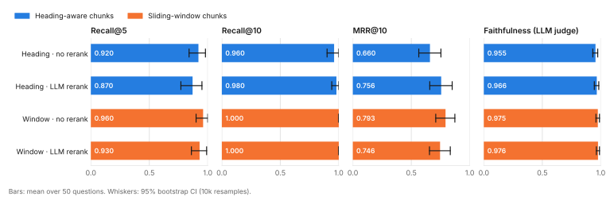
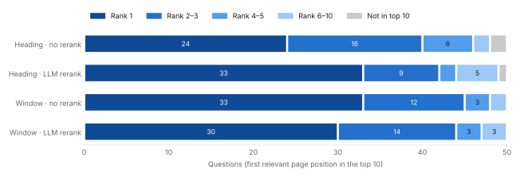
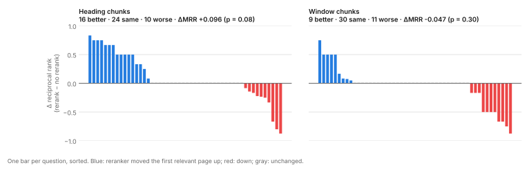
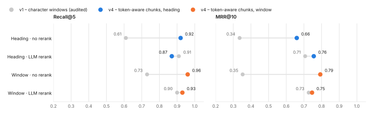

# Evaluation report

Run `20261119T184220545709Z` · 19 Nov 2026 (live follow-up checks: 25 Nov, [section 11](#11-live-checks-after-release)) · [raw results](../eval/results/20261119T184220545709Z) ·
[derived tables](results) · reproduce with `python scripts/analyze_eval.py`

## 1. Question

Which retrieval configuration should the assistant use by default — and is an LLM reranker worth its latency and cost?

Four configurations were compared on the same 50 questions, the same index snapshot, the same models and prompts:

| | No reranker | LLM reranker (top-20 → listwise) |
|---|---|---|
| **Heading chunks** — one chunk per section, split further only if > 512 tokens | `heading_rerank_off` | `heading_rerank_on` |
| **Window chunks** — sliding 512-token windows with 64-token overlap, labelled by the preceding heading | `window_rerank_off` | `window_rerank_on` |

## 2. Setup

| | |
|---|---|
| Corpus | `kubernetes/website@a96b3ebd15296afc96819e6e5f8a90bcff00b828`, `content/en/docs` + `content/en/releases`: **1,730 pages** |
| Chunks | heading **19,463** · window **12,625** · max 509 E5 tokens · **0** over the 512 limit (validated offline over every page) |
| Embeddings | `intfloat/multilingual-e5-base` (768-d, FP32 ONNX, local), `query:` / `passage:` prefixes |
| Candidates | dense top-30 (Qdrant, cosine) + BM25 top-30 (SQLite FTS5 on an LLM-translated English query) → weighted RRF (k = 60), ≤ 2 chunks per page → top-8 into the answer context |
| LLM | `glm-5.3-flash` for translation, reranking, answers and the judge, via an OpenAI-compatible router; temperature 0 (rerank, judge), 0.1 (answer) |
| Execution | 2 parallel questions, per-stage checkpoints, manifest-pinned configuration ([manifest](../eval/results/20261119T184220545709Z/manifest.json)) |

### Dataset

[`eval/questions.jsonl`](../eval/questions.jsonl) — 50 questions written in Russian for this project, each with a reference answer and one or more gold URLs on kubernetes.io. Topics: workloads (Pods, Deployments, StatefulSets, DaemonSets, Jobs), services and networking (Service types, DNS, Ingress, NetworkPolicy), configuration (ConfigMaps, Secrets, probes, resources), scheduling (taints, affinity, topology spread, eviction, QoS), storage (PV/PVC, StorageClass, snapshots), security (securityContext, ServiceAccounts, RBAC, admission), operations (kubectl, rollouts, logs, debugging, etcd backup, version skew) and architecture (control plane, scheduler, CoreDNS, garbage collection).

The language gap is deliberate: Russian questions against English documentation exercise the cross-lingual embedding model and the query translation used for BM25.

### Metrics

| Metric | Definition |
|---|---|
| **Recall@k** | Share of a question's gold pages that appear among the first *k* retrieved chunks. Compared at page level (URL without anchor); duplicate pages count once. Macro-averaged. |
| **Hit@k** | Share of questions with at least one gold page in the top *k*. |
| **MRR@10** | Mean reciprocal rank of the first chunk whose page is a gold page (0 if not in the top 10). |
| **Faithfulness** | LLM judge: share of the answer's claims directly supported by the context. The judge receives *exactly* the chunks the generator received. It does not score completeness or style. Invalid judge output is retried, never converted to a score. |

### Statistics

- **Confidence intervals:** 95 % percentile bootstrap over questions, 10,000 resamples, fixed seed.
- **Comparisons:** paired over the same questions. Bootstrap CI of the mean difference and a two-sided sign-flip permutation test (10,000 permutations).
- With n = 50, a difference must be roughly ≥ 0.08–0.10 in MRR to be detectable; smaller effects are reported but not claimed.

## 3. Results

### Main table

| Configuration | Recall@5 | Recall@10 | Hit@5 | MRR@10 | Faithfulness |
|---|---:|---:|---:|---:|---:|
| Heading · no rerank | 0.920 [0.84–0.98] | 0.960 [0.90–1.00] | 0.920 | 0.660 [0.56–0.75] | 0.955 [0.93–0.97] |
| Heading · LLM rerank | 0.870 [0.77–0.95] | 0.980 [0.94–1.00] | 0.880 | 0.756 [0.66–0.85] | 0.966 [0.94–0.98] |
| **Window · no rerank** | **0.960** [0.90–1.00] | **1.000** | **0.960** | **0.793** [0.71–0.87] | 0.975 [0.96–0.99] |
| Window · LLM rerank | 0.930 [0.86–0.99] | **1.000** | 0.940 | 0.746 [0.66–0.83] | **0.976** [0.96–0.99] |

### Paired comparisons

| Comparison | Metric | Δ mean | 95 % CI | p | better / same / worse |
|---|---|---:|---|---:|---|
| **Window vs heading (no rerank)** | **MRR@10** | **+0.133** | **[+0.053, +0.221]** | **0.003** | 13 / 32 / 5 |
| Window vs heading (no rerank) | Recall@5 | +0.040 | [−0.040, +0.120] | 0.623 | 3 / 46 / 1 |
| Window vs heading (no rerank) | Faithfulness | +0.020 | [−0.004, +0.045] | 0.138 | 18 / 24 / 8 |
| Window vs heading (with rerank) | MRR@10 | −0.010 | [−0.069, +0.045] | 0.751 | 11 / 33 / 6 |
| Window vs heading (with rerank) | Recall@5 | +0.060 | [−0.030, +0.150] | 0.310 | 5 / 43 / 2 |
| Rerank vs none (heading) | MRR@10 | +0.096 | [−0.006, +0.200] | 0.076 | 16 / 24 / 10 |
| Rerank vs none (heading) | Recall@5 | −0.050 | [−0.160, +0.060] | 0.501 | 3 / 41 / 6 |
| Rerank vs none (heading) | Faithfulness | +0.011 | [−0.011, +0.032] | 0.384 | 15 / 29 / 6 |
| **Rerank vs none (window)** | **MRR@10** | **−0.047** | [−0.133, +0.038] | 0.302 | 9 / 30 / 11 |
| Rerank vs none (window) | Recall@5 | −0.030 | [−0.100, +0.040] | 0.621 | 1 / 46 / 3 |
| Rerank vs none (window) | Faithfulness | +0.001 | [−0.015, +0.019] | 0.911 | 8 / 33 / 9 |

Full machine-readable output: [`docs/results/analysis.json`](results/analysis.json).

### First-relevant-rank distribution

| Configuration | Rank 1 | 2–3 | 4–5 | 6–10 | Not in top 10 |
|---|---:|---:|---:|---:|---:|
| Heading · no rerank | 24 | 16 | 6 | 2 | 2 |
| Heading · LLM rerank | 33 | 9 | 2 | 5 | 1 |
| Window · no rerank | **33** | 12 | 3 | 2 | **0** |
| Window · LLM rerank | 30 | 14 | 3 | 3 | **0** |

### Reranker effect per question

## 4. Findings

1. **Window chunking is the single most effective choice.** It lifts MRR@10 from 0.660 to 0.793 (p = 0.003) and is the only configuration that has the gold page in the top 10 for all 50 questions. Heading chunks follow the author's structure, but many Kubernetes sections are either very short (a definition without context) or very long (split arbitrarily anyway); overlapping windows give the embedding model more consistent units.
2. **The LLM reranker is not a free win.** On heading chunks it pulls the first relevant chunk up for 16 questions and down for 10 (net +0.096, not significant). On window chunks the effect is slightly negative. It adds a median 17.1 s per query and consumed 39 % of all input tokens of the benchmark. Default: **off**, available as a toggle.
3. **Faithfulness is high and flat (0.955–0.976).** With the right page almost always in context, answer groundedness is limited by the generator, not by retrieval. The differences between configurations are within noise.
4. **Citation markers were the weak spot of the generator**, not of retrieval — see below and the follow-up in [section 11](#11-live-checks-after-release).

### Citation compliance

The answer prompt requires a `[n]` marker for every verifiable claim.

| Configuration | Answers with ≥ 1 `[n]` marker | Markers pointing to a non-existent source | Median answer length |
|---|---:|---:|---:|
| Heading · no rerank | 24 / 50 | 0 | 1,446 chars |
| Heading · LLM rerank | 28 / 50 | 0 | 1,453 chars |
| Window · no rerank | 34 / 50 | 0 | 1,466 chars |
| Window · LLM rerank | 31 / 50 | 0 | 1,516 chars |

The model never invents a source number, but it frequently answers in a structured "article" format without markers, even when every claim is grounded (faithfulness 1.0). The UI always shows the source list, so the user can still verify. **Follow-up (25 Nov):** a controlled re-run showed that the same prompt now yields markers in 50/50 answers — the gap was provider-side drift, not the prompt ([section 11.1](#111-citation-markers-prompt-or-provider)).

## 5. Error analysis

Questions where the best configuration (`window_rerank_off`) ranked the gold page 4th or lower — with what it ranked above it:

| Q | Question (translated) | Gold page | Rank | Ranked higher |
|---|---|---|---:|---|
| q002 | What is a Deployment for and how does it update an app? | `concepts/workloads/controllers/deployment/` | 4 | the *Performing a Rolling Update* tutorial (×2), ReplicationController › ReplicaSet |
| q011 | Why is a Secret not encrypted by default? | `concepts/configuration/secret/` | 7 | *Decrypt data encrypted at rest*, *KMS provider* (×2), *Good practices for Secrets*, *Encrypting data at rest*, and one off-topic hit (*Storage Classes › Ceph RBD*) |
| q022 | What is eviction in Kubernetes? | `concepts/scheduling-eviction/api-eviction/` | 8 | *Node-pressure eviction* (×3), *API-initiated eviction* and *Eviction* glossary entries, the *Scheduling, Preemption and Eviction* overview, *Pod Priority and Preemption* |
| q028 | How are PV and PVC related? | `concepts/storage/persistent-volumes/` | 5 | the *Configure a Pod to Use a PersistentVolume* task (×2), PVC API reference, a feature-gate page |
| q036 | How to check a rollout and roll back? | `concepts/workloads/controllers/deployment/` | 4 | the *Update a Deployment Without Downtime* task (×2), the canary deployment tutorial |

In almost every case the pages ranked above the gold page **answer the question too** — a tutorial, a task page, a glossary entry or the API reference; only two of the 23 higher-ranked chunks are off-topic. The single-gold-page labelling is therefore conservative: true retrieval quality is somewhat higher than the reported Recall@5/MRR. A natural next step is graded relevance labels (gold + acceptable pages) and nDCG.

## 6. Cost and latency

| Operation | Calls | Failed | p50 | p90 | Input tokens | Output tokens | Cost (USD) |
|---|---:|---:|---:|---:|---:|---:|---:|
| Answer generation | 200 | 0 | 28.4 s | 39.4 s | 1,025,597 | 153,048 | 0.0614 |
| Faithfulness judge | 200 | 0 | 15.3 s | 27.0 s | 881,402 | 41,468 | 0.0402 |
| LLM rerank | 112 | 11 | 17.1 s | 27.7 s | 1,228,788 | 46,398 | 0.0544 |
| **Total** | **512** | **11** | | | **3,135,787** | **240,914** | **0.1560** |

- Tariff: $0.039 / 1M input, $0.14 / 1M output (reasoning tokens are part of `completion_tokens` and are not counted twice). Snapshot in [`data/billing/pricing.json`](../data/billing/pricing.json).
- Each API call is logged with its usage, the tariff snapshot at call time, prompt hash and duration ([`api-responses.jsonl`](../eval/results/20261119T184220545709Z/api-responses.jsonl)). 77 early records were priced after the fact from the same tariff because the pricing path was misconfigured at the start; the original log was not modified.
- The 11 failed calls are reranker connection errors that were retried. They returned no `usage`; their cost is reported as *unknown*, not zero (`fully_metered: false`).
- The original pre-run estimate was $0.14–0.43 depending on reasoning length; the actual metered cost landed at the low end.
- Latencies are those of the provider for a reasoning model and dominate end-to-end time. Local retrieval stages were not timed in this run; the chat API now reports per-stage timings in every response.

## 7. Before and after the audit (v1 → v4)

The first run (`20261114T152921Z`) is kept with an offline audit ([summary](../eval/results/20261114T152921Z/audit/summary.md)). Its retrieval results were re-scored with the corrected metric; nothing was re-run or edited.

| Configuration | v1 Recall@5 | v4 Recall@5 | v1 MRR@10 | v4 MRR@10 |
|---|---:|---:|---:|---:|
| Heading · no rerank | 0.610 | 0.920 | 0.336 | 0.660 |
| Heading · LLM rerank | 0.910 | 0.870 | 0.707 | 0.756 |
| Window · no rerank | 0.730 | 0.960 | 0.353 | 0.793 |
| Window · LLM rerank | 0.900 | 0.930 | 0.727 | 0.746 |

What changed between the two runs:

- **Token-aware chunking.** The E5 tokenizer showed 3,935 / 18,121 heading and 3,940 / 12,019 window chunks above the 512-token limit (max 1,417) — their tails were silently dropped at embedding time.
- **Hugo shortcodes.** `code_sample`, `codenew`, `code` and `include` were stripped, so YAML manifests and shared snippets were missing. They are now expanded from the repository, included in the page hash, and protected inside fenced code.
- **Metadata.** Explicit `{#anchor}` headings, duplicate anchors, branch-bundle slugs and Hugo heading translations are resolved, so citations link to the right section.
- **Metric and judge.** Recall replaced HitRate; the judge sees only the generator's context; unparsable outputs are retried instead of becoming zeros. v1 had 5 zero judge scores and 6 all-zero rerank lists that cannot be attributed after the fact — they are flagged, not removed.

Interpretation: in v1 the reranker was compensating for broken retrieval (MRR 0.35 → 0.73). Once retrieval was fixed, the plain hybrid pipeline (0.79) beat the old reranked one, and the reranker lost its advantage. The two runs differ in more than one variable, so this is a before/after of the pipeline, not a controlled experiment.

## 8. Indexing performance

| | |
|---|---|
| CPU (6 threads, batch 4), E5-base FP32 ONNX | ≈ 122 chunks/min (benchmark on 32 window chunks) |
| GPU (GTX 1060 6 GB, ONNX Runtime DirectML, static `[4, 512]` shape) | ≈ 1,340 chunks/min inference (2 × 16-chunk repeats) |
| CPU ↔ GPU equivalence | min cosine 1.0, max abs component error 4.96 × 10⁻⁷ on 24 inputs |
| Real resume of the window index on GPU | 858 pages / 9,158 chunks in 38 min 40 s, including I/O and Qdrant/SQLite writes |
| Incremental re-run after a full index | `added = changed = deleted = 0`, `unchanged = 1,730` (dry run, both strategies) |

The GPU worker was a one-off accelerator for a Windows machine and is not part of the Docker stack; the samples for CPU and GPU differ, so the ratio is indicative only.

## 9. Reproducibility

- All 200 records include the question, gold URLs, the 10 retrieved chunks with ranks and scores, the translated BM25 query, the exact answer context, the answer and the judge score.
- `scripts/analyze_eval.py` regenerates every table and chart in this report and the README from those files, offline. CI re-runs it and fails if the derived tables drift.
- A new run: `python -m app.cli evaluate --with-faithfulness --workers 2`. It refuses to start until both indexes match the current source, chunker and embedding model, and `resume-evaluation` refuses to mix results if any of provider, models, settings, questions or index hashes changed.

## 10. Limitations

- n = 50; effects smaller than ~0.08 MRR are not resolvable.
- One generator/judge model; the judge is the same model family as the generator, which can bias faithfulness upward.
- One gold page per question for most questions (see error analysis).
- Answer correctness against the reference answers was not scored; only groundedness was.
- The answer prompt was later generalised from "answer in Russian" to "answer in the language of the question"; for this Russian dataset the instruction is equivalent, but the change is noted for completeness.

## 11. Live checks after release

25 Nov 2026 · same model (`glm-5.3-flash`) through the same OpenAI-compatible router · budget-capped harness
[`scripts/experiments/live_checks.py`](../scripts/experiments/live_checks.py) · raw logs and summaries in
[`eval/experiments/`](../eval/experiments) · total metered cost **$0.061** (245 calls; one answer call timed out and was retried — its cost, if any, is unknown; the single `stream_options` probe was not metered).

### 11.1 Citation markers: prompt or provider?

Section 4 found `[n]` markers in only 34 of 50 answers. Before changing the prompt, the question was whether a prompt change would actually be the cause of any improvement. Design: regenerate answers for all 50 questions from the **recorded** answer contexts of `window_rerank_off` (so retrieval is held fixed), with

- **control_v2** — the exact benchmark prompt, run again today;
- **v3** — a prompt with explicit citation rules (a marker after every factual sentence or list item, an example, no markers inside code, "an answer without citations is not acceptable");

and score every answer with the same faithfulness judge.

| Variant | Answers with `[n]` | Lines with a marker¹ | Faithfulness | Median length |
|---|---:|---:|---:|---:|
| Benchmark answers (19 Nov, recorded) | 34 / 50 | 0.57 [0.45–0.69] | 0.975 [0.96–0.99] | 1,466 chars |
| control_v2 — same prompt, 25 Nov | **50 / 50** | 0.86 [0.81–0.91] | 0.987 [0.98–1.00] | 1,559 chars |
| v3 — strict citation prompt, 25 Nov | **50 / 50** | 0.88 [0.83–0.93] | 0.988 [0.98–1.00] | 1,450 chars |

¹ Share of prose lines (paragraphs and list items, excluding headings, code and table rules) that carry at least one marker. 0 markers pointed to a non-existent source in every variant. Paired v3 − control: lines with a marker +0.018 [−0.04, +0.07], p = 0.56; faithfulness +0.001 [−0.01, +0.01], p = 1.0.

**Conclusion.** The same prompt that produced 34/50 cited answers on 19 Nov produced 50/50 on 25 Nov, with higher faithfulness. The gap was a change in the provider-side model behaviour, not a prompt problem, and the stricter prompt adds nothing measurable on top. Without the control arm the improvement would have been wrongly credited to v3. The production prompt is therefore left unchanged; the planned "rewrite if no markers" fallback was not needed and was not run.

Practical lesson: hosted models drift under the same name. Re-running a small control set before attributing a change to a prompt costs cents ($0.03 here) and avoids a false conclusion.

### 11.2 Intermittent HTTP 400 — reproduced and explained

The owner saw occasional HTTP 400 errors in the chat, with and without the reranker. Two sessions on the same day tell the story.

**Morning (12:30 UTC) — nothing to see.** 44 calls replayed every request shape the application sends, without retries: 20 identical translations, a 4,000-character question, follow-up rewriting, a 20-candidate rerank, streamed and blocking answers. Together with the citation experiment, 0 of 244 application-shaped calls failed. The only reproducible 400 came from `stream_options: {include_usage: true}`, which the application never sends (the router reports streaming usage in the final chunk without it).

**Evening (18:00–18:55 UTC) — the error, live.** During latency measurements the provider started returning `{"code": 400, "message": "invalid request"}`:

| Observation | Result |
|---|---|
| Probes with a fresh, trivial request every 3 min ([log A](../eval/experiments/http400-diagnostics/provider-probe-a.jsonl)) | 24 of 30 failed: failing 18:11–18:24, 18:30–18:43 and from 18:53; healthy only at 18:27 and 18:47–18:50 |
| Same request repeated 5× | deterministic within a period: 3 questions failed 5/5 while 2 others succeeded 5/5 |
| Changed temperature, `max_tokens`, streaming, message layout, added a random nonce | no effect — even "Reply with the single word: ok" failed |
| Previously successful prompts, repeated verbatim | kept succeeding (consistent with a router-side response cache) |
| A second router with the same model ([log B](../eval/experiments/http400-diagnostics/provider-probe-b.jsonl)) | the same 400, now with an explicit `"code": "upstream_rejected"`; 7 of 14 probes failed, in overlapping windows |
| Failure latency | either < 2 s or a ~11 s hang before the 400 |

**Conclusion.** The intermittent 400s come from the model's upstream provider, behind both routers, in time windows; they are not caused by the application's requests (the morning session's identical requests all succeeded, the evening's trivial requests failed). The error code is misleading — it looks like a client error but is an upstream rejection.

**What the application does about it.**

- **Translation fails** → BM25 runs on the original wording and the answer still comes (`translation_failed` in the trace). In the first evening run, all 10 questions were answered although 3 of 5 translations failed ([run](../eval/experiments/latency/degraded-provider-run.json)).
- **Translation hangs** → capped at 8 s in chat (successful translations: 1.6 s median, 5.4 s p90; failing ones hung 10–24 s), single attempt, then the same fallback.
- **Reranker fails** → hybrid order is kept (`rerank_failed`).
- **Answer generation fails** → there is no honest fallback; the user gets the stage, the model and a diagnostic ID, and a *Retry* button. In the second evening run 3 of 10 answers failed this way — an HTTP 403 and two streams cut mid-response ([run](../eval/experiments/latency/second-run.json)).
- Production deployments should add a second, independent model provider for the answer stage; the two routers available here shared one upstream and failed together.

### 11.3 Latency, for reference

Local retrieval is fast and stable; the provider dominates end-to-end time and varies by day:

| Stage | Measured |
|---|---|
| Query embedding (E5, CPU) | 30–65 ms (one 3.6 s cold start after a restart) |
| Vector search, Qdrant top-30 | 9–21 ms |
| BM25, SQLite FTS5 top-30 | 2–132 ms |
| Sources ready, English or cached question | ≈ 0.2–0.3 s |
| RU→EN translation (new Russian question) | 1.6 s median, 5.4 s p90 when healthy |
| First answer token | median 3.3 s over 17 streamed answers (1.4–28.9 s; the tail is a stalled translation or provider) |
| Full answer | 2.4–54 s |

Batch figures on 25 Nov: answer 18.4 s median (p90 35.8 s) and judge 7.1 s (p90 20.5 s) under 4 parallel workers. The benchmark numbers in section 6 are kept as measured on 19 Nov.

## 12. Unanswerable questions (refusal test)

A RAG system is only trustworthy if it says "not in the documentation" instead of inventing an answer. 20 questions written in Russian, none answerable from the Kubernetes docs ([questions](../eval/experiments/refusals/questions.jsonl), [answers](../eval/experiments/refusals/results.jsonl)), run through the production chat path — window chunks, hybrid retrieval, no reranker, unchanged answer prompt.

| Category | Example | n | Declined | Corrected the premise | Fabricated |
|---|---|---:|---:|---:|---:|
| Out of scope | streaming replication in PostgreSQL 16; GitHub Actions for Python | 7 | 7 | 0 | **0** |
| Non-existent feature | `kubectl --auto-heal-nodes`, `spec.autoRollbackOnFailure`, "built-in KubeMesh" | 8 | 3 | 5 | **0** |
| Removed API | dockershim in 1.30, PodSecurityPolicy in 1.29, Ingress `extensions/v1beta1` | 3 | 0 | 3 | **0** |
| Vendor-specific fact | etcd version in EKS 1.29, default max pods in AKS kubenet | 2 | 2 | 0 | **0** |
| **Total** | | **20** | **12** | **8** | **0** |

Labels from a manual review of all 20 answers. An LLM judge (same model) agreed on "no fabrication" in 20/20 and differed only on declined vs corrected for five non-existent-feature questions, where the answer both says the sources lack the item and explains the real mechanism (e.g. Kubernetes does not roll back Deployments automatically; StatefulSet updates always recreate Pods).

- Every removed-API answer states the right version (dockershim removed in 1.24, PodSecurityPolicy in 1.25, `extensions/v1beta1` Ingress in 1.22) and names the replacement, with citations.
- The converse holds as well: none of the 200 benchmark answers — all answerable — opens with or contains a refusal phrase, so the model does not over-refuse.
- The run happened during the provider incident described in §11.2: 10 of 20 query translations failed or hit the 8-second cap and BM25 used the original Russian wording. No answer fabricated even so — the test also exercised the degraded retrieval path under real failure conditions.
- Metered cost: $0.005.

## 13. Retrieval ablations

Same 50 questions, same restored index, top-10, no LLM calls: BM25 uses the English query translations recorded in the benchmark ([script](../scripts/experiments/ablations.py), [raw](../eval/experiments/retrieval-ablations)). Δ is the paired difference to the default hybrid with a sign-flip permutation p-value.

| Variant | Window R@5 | Window MRR@10 | Δ MRR (p) | Heading R@5 | Heading MRR@10 | Δ MRR (p) |
|---|---:|---:|---|---:|---:|---|
| **Hybrid, RRF k = 60 (default)** | 0.96 | 0.793 | — | 0.90 | 0.652 | — |
| Dense only | 0.90 | 0.665 | -0.127 (0.019) | 0.90 | 0.659 | +0.006 (0.908) |
| BM25 only (translated query) | 0.87 | 0.665 | -0.128 (0.004) | 0.83 | 0.632 | -0.020 (0.662) |
| BM25 only, untranslated query | 0.67 | 0.443 | -0.349 (< 0.001) | 0.62 | 0.448 | -0.204 (0.003) |
| Hybrid, untranslated BM25 query | 0.86 | 0.651 | -0.142 (0.004) | 0.76 | 0.547 | -0.105 (0.052) |
| Hybrid, k = 10 | 0.92 | 0.800 | +0.007 (0.784) | 0.92 | 0.647 | -0.006 (0.494) |
| Hybrid, k = 30 | 0.96 | 0.789 | -0.003 (1.000) | 0.90 | 0.654 | +0.002 (1.000) |
| Hybrid, k = 100 | 0.96 | 0.793 | +0.000 (1.000) | 0.90 | 0.652 | +0.000 (1.000) |
| Hybrid, dense weight × 2 | 0.94 | 0.795 | +0.003 (0.923) | 0.88 | 0.652 | -0.000 (1.000) |
| Hybrid, BM25 weight × 2 | 0.96 | 0.794 | +0.001 (1.000) | 0.88 | 0.650 | -0.003 (0.940) |
| Hybrid, no per-page cap | 0.95 | 0.787 | -0.006 (0.244) | 0.87 | 0.644 | -0.008 (0.246) |

**Reproduction check.** The default variant re-runs the benchmark's no-rerank configurations on the repaired index: window — 50/50 identical top-10 lists and 50/50 identical first-relevant ranks; heading — 47/50 and 49/50. The few heading differences are near-ties flipped by floating-point differences between the original and the re-computed embeddings (heading MRR 0.652 here vs 0.660 in the benchmark).

**Findings.**
- **On window chunks, hybrid retrieval is clearly better than either channel** (−0.127 MRR for dense-only, p = 0.019; −0.128 for BM25-only, p = 0.004).
- **On heading chunks it is not:** dense-only (0.659) and hybrid (0.652) are indistinguishable. A plausible reason (not tested separately): section-sized chunks already lead with their own heading and page title, the signal BM25 contributes on window chunks. The hybrid gain is a property of the chunking, not a law.
- **Query translation is what makes BM25 useful** for Russian questions over English docs: without it BM25 loses 0.20–0.35 MRR, and window hybrid falls to the level of a single channel.
- **RRF parameters do not matter here** — k from 10 to 100 and 2× channel weights stay within ±0.01 MRR. Nothing is tuned to these 50 questions.
- **The per-page diversity cap** has no significant effect on these metrics (−0.006 / −0.008 without it); it is kept because it stops one long page from filling the answer context, which these metrics do not measure.

## 14. Incident: a packaged index with all-zero vectors

**What happened.** To make the demo and ablations reproducible without re-embedding, the index was exported from the development machine as Qdrant snapshots plus the SQLite file. Restored here, every vector in both collections was zero — 32,088 of 32,088 — while point IDs, payloads and SQLite were intact. Qdrant returned zero vectors without any error; vector search silently degenerated into arbitrary order, so hybrid results would have rested on BM25 alone.

**Diagnosis.**
- A fresh collection in the same Qdrant stored and returned vectors correctly, so the server was fine.
- Reading the snapshot files directly, without Qdrant: in all 12 segments the region that should hold the vectors was zero-filled, and the vector files were larger than the configured chunk size.
- The benchmark itself was unaffected: its recorded dense similarity scores are 0.80–0.91, impossible with zero vectors. The running Qdrant had correct vectors in memory.
- Most likely cause: Qdrant persisted vectors through memory-mapped files on a host folder bind-mounted from Windows into the container, where mmap writes are not reliably flushed to the file share.
- The package's own restore check compared the restored collection with the stopped source — zeros with zeros — and passed. A check has to compare against an independent source of truth.

**Fix.**
1. `docker-compose.yml` now stores Qdrant data in a named volume ([ADR 0006](adr/0006-qdrant-named-volume.md)).
2. `app.cli verify-index` checks page hashes against the docs source, chunk IDs between SQLite and Qdrant, vector norms, and re-embeds a random sample of chunk texts to compare with the stored vectors.
3. `app.cli repair-vectors` re-embedded all 32,088 vectors from the chunk text stored in the payloads — same IDs, same chunking, same page hashes; resumable (it survived a Qdrant restart mid-run).
4. `app.cli export-index` / `restore-index` package and restore the index with a SHA-256 manifest; the published archive is built from the verified, repaired index.

**Verification of the repaired index.**
- All 1,730 page hashes match the hashes recomputed from `kubernetes/website@a96b3eb` and the benchmark manifest.
- All vectors are unit-norm; re-embedding random samples gives cosine similarity ≥ 0.99999999.
- The default configuration reproduces the benchmark retrieval: for window chunks **50/50 questions return the identical top-10 chunk list** and the same first-relevant rank as on 19 Nov — although the original window vectors were computed on a GPU and the repaired ones on a CPU; for heading chunks 47/50 lists are identical (near-ties, see §13).
